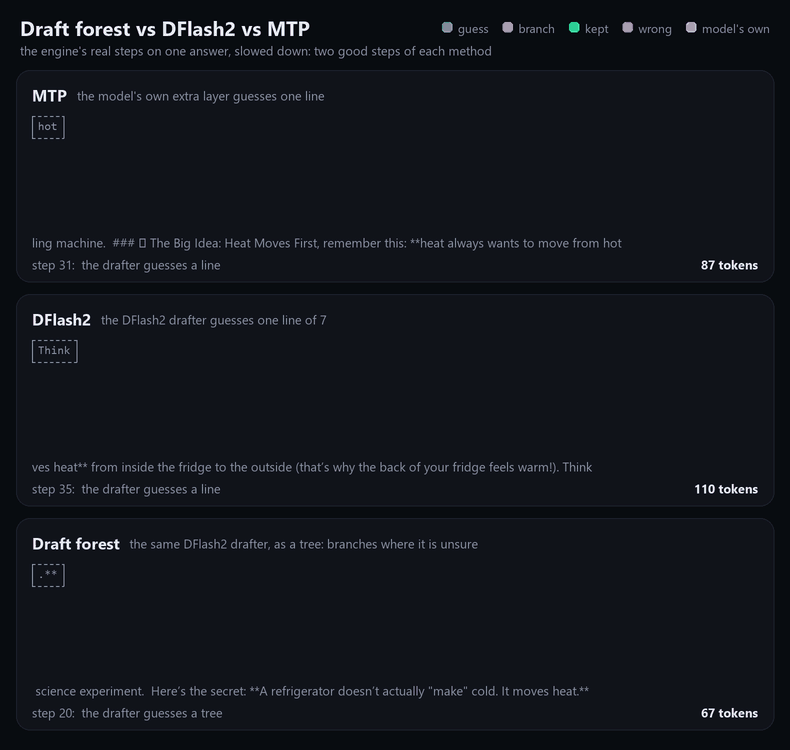
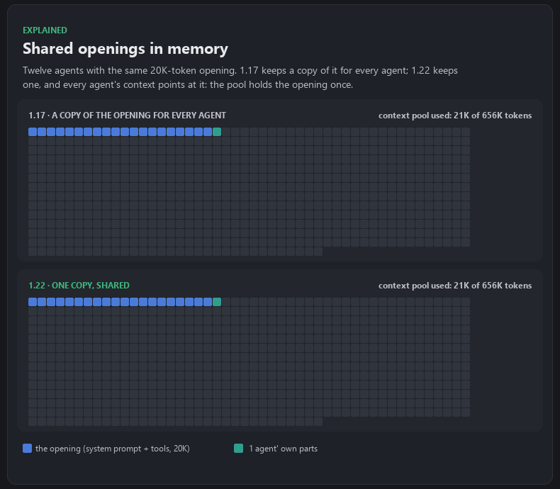
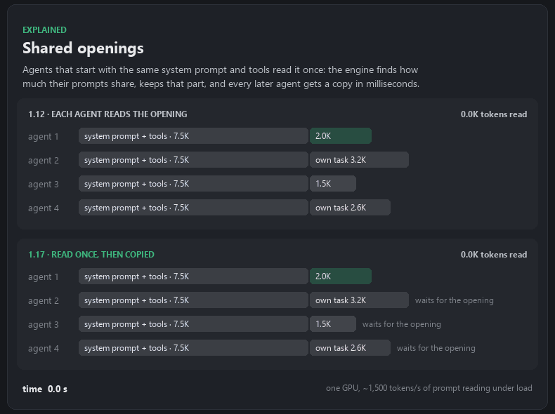

# Changelog

What changed in each release of MegaCapybara. Downloads are on the [releases page](https://github.com/perkel666/MegaCapybara/releases).

## 1.36 (2026-10-20)

### New model: Qwen3.8 Flash-Next

- **MegaCapybara now runs Qwen3.8 Flash-Next**, a 177-billion-parameter mixture-of-experts model, on one RTX 5090. Its
  experts don't all fit in the card's memory, so the most used ones stay on the GPU and the rest are read from RAM.
  While you work, the engine moves the experts your work needs most into VRAM.
- **It comes in two sizes.** Tiny stores the experts at 2 bits and is faster with more room for context. Small stores
  them at 3 bits and gives answers closer to the original model.
- **Uncensored versions of both sizes are available too.** The launcher downloads all four from Hugging Face:
  [perkel/Qwen3.8-Flash-Next-MC](https://huggingface.co/perkel/Qwen3.8-Flash-Next-MC) and
  [perkel/Qwen3.8-Flash-Next-Uncensored-MC](https://huggingface.co/perkel/Qwen3.8-Flash-Next-Uncensored-MC).
- **Flash-Next uses a DFlash2 drafter to write faster.** The drafter guesses the next tokens and the model checks them,
  so the answers stay the model's own. With Tiny on coding work, one agent goes from 440 to 498 tokens per second and
  eight agents together go from 779 to 993, compared with the model's own MTP layer. The launcher downloads the drafter
  with the model. If the drafter is missing, the MTP layer is used instead.
- **Flash-Next can read images.** Its vision encoder stays in RAM, so it takes no GPU memory away from the experts.
- **Flash-Next handles long conversations of up to a million tokens.** You can store the context at 8, 6 or 4 bits per
  value to fit more of it.
- **Many agents start faster on Flash-Next.** When several agents send new prompts at the same time, the engine reads
  them together in one pass. Twelve agents' new prompts took 6.7 seconds instead of 13.

### All models

- **Agents that don't use a drafter now share their work.** Before, each one ran in turn. Now they are processed
  together, so eight agents on the 27B Medium model reach 622 tokens per second instead of 92.
- **Images are processed faster.** A one-megapixel image now takes 50 milliseconds instead of 221.
- **A short opening that many requests share is now kept in memory.** Before, it could be pushed out by longer ones
  and read again every time.
- **Conversations that have just answered are no longer the first to be removed** when the RAM cache is full.

### Fixed

- Emoji and other characters that span two tokens came out as `�` in tool-call arguments, which could break an agent's
  file edits.
- When the loop guard stops an answer, the OpenAI API now reports `finish_reason` "length". It used to report
  "repetition", which some clients such as OpenCode rejected.
- The server could fail with "save KV: out of memory" and stop answering when many experts or conversations were held
  in RAM. It now stays within the memory that Windows lets the GPU use.
- Requests that ask for no thinking are now honoured in every common form.
- Requests are no longer limited in how many images they can contain.

### Launcher

- The download panel groups models by family, Qwen3.8 27B and Qwen3.8 Flash-Next. One Download button gets a model with
  everything it needs.
- The monitor shows a queued request and the conversation it continues as a single entry.

## 1.35 (2026-10-07)

- **Draft forest.** When you pick DFlash2, the engine now treats the drafter's guesses as a tree. Where the drafter is
  unsure, it also tries its second and third choices, so a wrong guess on one branch is often caught by another. With
  several agents, all their trees are checked together, and the space goes to the guesses most likely to be kept.
  Compared with 1.17, twelve agents are about 26% faster on code and 20% faster on prose. One agent is about 5% faster
  on code and 10% faster on prose.

  

- **Many agents together produce more tokens per second.** The steps they share became cheaper.
- **New requests no longer pause the server.** Each new request used to cause a stall of about 25 milliseconds.
- **Agents with the same opening share one copy of it in memory.** Twelve agents with the same 20,000-token opening now
  use 88% less of the context pool. The opening also moves to the RAM cache as a single copy.

  

- **The model files were measured again with this version** and their scores were updated on Hugging Face, so the
  launcher's projections for DFlash2 now reflect the draft forest. Coding with eight agents, compared with 1.17:

  | Size | 1.17 | 1.35 |
  |---|--:|--:|
  | Tiny | 1,890 | 2,333 |
  | Small | 1,755 | 2,379 |
  | Medium | 1,638 | 2,203 |
  | Large | 1,427 | 1,953 |
  | XXL | 1,255 | 1,645 |

  Tokens per second. One agent alone is as fast as before. This release replaces 1.34, which was published earlier the
  same day with figures measured on a freshly started server.
- **Crashes and hangs are now reported.** The log shows where the server stopped, down to the function and line, and a
  crash dump is saved in `logs\`. The file `megacapybara.pdb` ships beside the server for this.

### Fixed

- The server could crash when a shared opening was kept while the RAM cache was nearly full.
- The monitor could freeze under heavy load.
- Agents re-read their whole conversation after part of its cache had moved to RAM.
- A cached conversation was sometimes read again from scratch when VRAM was briefly short.
- All running conversations could end at once when a conversation came back from RAM while the RAM cache was full.
- The monitor listed idle conversations as held in VRAM when most of their cache was in RAM.

## 1.17 (2026-10-05)

- **Shared openings are read once.** When agents start with the same system prompt and tools, that part is read only
  once, and later agents copy it in milliseconds. Prompts sent at the same time, such as a batch of new agents or the
  conversations coming back after a restart, wait for the first one instead of each reading the opening. The engine
  finds the shared part by itself.

  

- The log now says when a conversation cannot be resumed and why.
- The log now says when a shared opening is kept or reused.

### Fixed

- Agents re-read their whole conversation on every turn in 1.12. Under heavy load, 1.12's RAM cache could fill the
  memory Windows lets the GPU use, and conversations lost the point they could resume from. On one busy session, 110
  turns in 27 minutes re-read 4.8 million tokens. 1.17 counts the memory the cache really holds and keeps room for every
  running conversation.

## 1.12 (2026-10-05)

- **Prompts are read about 8-9% faster.** Eight prompts of about 11,000 tokens read together went from 7,400 to 8,100
  tokens per second, and a 145,000-token prompt went from 5,200 to 5,600 tokens per second (small model, RTX 5090).
- **Long conversations generate faster.** Each speculative round is 4-9% faster between 8,000 and 240,000 tokens of
  context, and up to 20% faster with long drafts. Short conversations are unchanged.
- **Agents keep their cache while they wait.** A conversation now counts as finished only after 20 minutes without a
  turn.
- **A conversation whose last tool call runs in the background stays open.** This covers tools started with
  `run_in_background`.
- The shared context is about 3% smaller, because the buffers for reading prompts are larger.

## 1.08 (2026-10-04)

- **You can see where each conversation's context is.** The monitor's Conversations tab shows VRAM, RAM and disk side
  by side, with each conversation as a dot sized by its context. A prompt that is being read shows in its slot.
- **A new Statistics tab replaces the launcher's server log.** It shows how the slots spent the last 10 minutes and
  the time since the server started, so you can see whether your clients send enough work or requests wait for
  context.
- **The cache uses the disk only as a last resort.** Caches of finished jobs are removed first and are never written to
  disk.
- **Nothing that has been idle for an hour stays on disk.**
- **An active conversation's state stays in RAM.** On a busy hosted hour, these changes avoided thousands of trips to
  the disk and the wait of about 3 seconds they added to agent turns.
- The server's log tags every conversation with `[conv N]`, so you can follow its turns and its cache.

## 1.04 (2026-10-03)

- **Downloads are counted on Hugging Face.** After the launcher downloads a model, it requests that model repository's
  `config.json` once, so Hugging Face counts the download. Nothing about you or your PC is sent.

## 1.03 (2026-10-03)

Conversations keep their cache when many agents share the server. Under memory pressure, 1.02 could drop a whole idle
conversation, often 100,000 to 300,000 tokens long, and read it again from scratch on its next turn.

- A conversation coming back from RAM no longer causes another one to be dropped. It swaps places with an idle one.
- When pinned RAM runs out, another conversation moves to disk instead of the one being moved being dropped.
- The conversations needed last make room first. A conversation is never pushed out for one that is needed later.

## 1.02 (2026-10-03)

- First public release: the server and the launcher for Windows 11 and Linux, the presets, and model downloads from
  Hugging Face in the launcher.
